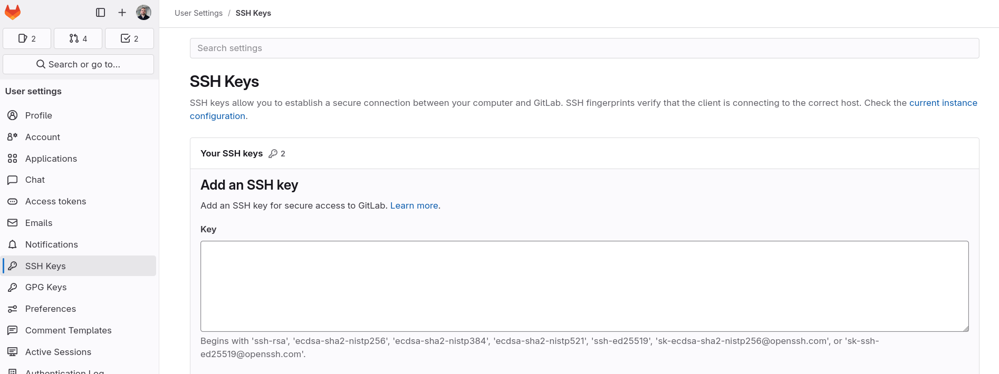

# Installation

Table of Contents:
- [For Windows](#for-windows)
- [For Linux (Ubuntu/Debian)](#for-linux-ubuntudebian)
- [For MacOS](#for-macos)

## For Windows:

### 1. Install the Java Development Kit (JDK)

1. Download JDK 21 from [Oracle JDK](https://www.oracle.com/java/technologies/downloads/)
2. Run installer
   - Select installation directory
   - Choose components to install
   - Complete installation wizard
3. Set Environment Variables
   - Open System Properties
   - Click "Environment Variables"
   - Create new system variable:
     * Variable Name: `JAVA_HOME`
     * Variable Value: `C:\Program Files\Java\jdk-21`
   - Edit "Path" variable
   - Add `%JAVA_HOME%\bin`
4. Verify installation:
   - Open Command Prompt
   - Run `java --version`

For further details, you may refer to the [official documentation](https://docs.oracle.com/en/java/javase/21/install/installation-jdk-microsoft-windows-platforms.html) regarding the installation on Windows.

### 2. Install Docker

1. Download Docker Desktop from the [official website](https://docs.docker.com/desktop/setup/install/windows-install/).
2. Run the installer and follow the installation wizard.
3. Once installed, launch Docker Desktop.
4. Go to `Settings - Resources - Network`. Activate host networking.
5. **Verify the installation** by running the command:

```bash
# Check docker and compose versions
docker --version
docker compose --version
```

**Troubleshooting**: To use Docker, open the Docker Desktop app on your Windows computer.

For further details, you may refer to the [official documentation](https://docs.docker.com/desktop/setup/install/windows-install/) regarding the installation on Windows.

### 3. Install Git

1. Download the installer from the [official website](https://git-scm.com/install/windows).
2. Run the installer and follow the installation wizard.
3. **Verify the installation** by running the command:

```bash
# Check git version
git --version
```

### 4. Install Python (via Miniconda)

For this course, you'll need to have the following software installed on your computer:

- Python 3 (e.g. via Anaconda, local installation/virtual environment)
- Build-essential packages/tools to compile software (i.e., build-essential deb package in Ubuntu)

It is advisable to use **virtual environments** for installing your project's dependencies. This practice isolates your project's dependencies from the system installation and helps to prevent conflicts with dependencies from other projects.

1. Follow the instructions from the [official website](https://www.anaconda.com/docs/getting-started/miniconda/install#command-prompt).
2. Run the installer and follow the installation wizard. **Install only for your user.**
3. Add the following to your environment variables (PATH): `C:\Users\USERNAME\miniconda3\Scripts`
4. **Verify the installation** by running the command:

```bash
# Check conda version
conda --version
```

> The command `$ conda create -n sinf python=3.8` creates a virtual environment for your project. The VE can be "activated" using `conda activate sinf`. This will prepend that directory to your PATH, so that running python or python3 will invoke the VE's interpreter. Subsequently, all installed packages will be located in this folder.

**Follow these steps to create the virtual environment and install the dependencies.**

```bash
# 1. Navigate to your repository folder
cd <repository_path>

# 2. Create a virtual environment (VE) using Python's venv module
conda create -n sinf python=3.8

# 3. Activate your virtual environment
conda activate sinf

# 4. Install requirements (you need to activate your virtual environment)
pip install -r <path_to_requirements.txt>
```

### 5. Download the Project (sinf-template)

> This step assumes you have forked the template repository and created your own group's repository.

Start by cloning the template repository to your home folder (typically `/home/<username>`). **This step should be done within WSL.**

```bash
# Clone the repository or download the files
git clone git@<replace with your project's uri>
```

**Troubleshooting**: You can create an SSH key and add it to your GitLab account. This way, you won't have to enter your password and username every time.

```bash
# 1. Create an SSH key (Accept all the prompted steps and do not enter a passphrase)
ssh-keygen -t ed25519

# 2. Display the contents of your public SSH key
cat ~/.ssh/id_ed25519.pub

# 3. Copy the contents and paste them on the designated page in GitLab.
```


### 6. Downloading 4DIAC-IDE (comes pre-compiled)

Pre-compiled versions of 4DIAC/IDE are available in a [**Google Drive folder**](https://drive.google.com/drive/folders/1Vzk5gPqLEdzNYRh07CeF5kyupZAS7RZL?usp=sharing).

1. Download 4DIAC-IDE version 1.11.0 from the previous link.

2. Select the version specific for your operating system and download the file.

3. Copy the compressed folder to the root of your repository and unpack the file to your project's root directory.

You will end with the following directory structure:

```text
sinf-template/
 - 4diac-ide/
 - docker/
 - docs/
 - project/
 - scripts/
 ...
```

> That's it for installing the software stack for the project. You can now start by checking the tutorials that we have available for you.

## For Linux (Ubuntu/Debian):

### 1. Install the Java Development Kit (JDK)

```bash
# 1. Update package list:
sudo apt update

# 2. Install OpenJDK:
sudo apt install openjdk-21-jdk

# 3. Verify installation:
java --version
```

### 2. Install Docker

**Disclaimer**: The following installation instructions might be outdated, please check the [official source](https://docs.docker.com/engine/install/ubuntu/) for updated content.

```bash
# Update package index
sudo apt-get update

# Install dependencies
sudo apt-get install apt-transport-https ca-certificates curl software-properties-common

# Add Docker's official GPG key
curl -fsSL https://download.docker.com/linux/ubuntu/gpg | sudo apt-key add -

# Set up the Docker repository
sudo add-apt-repository "deb [arch=amd64] https://download.docker.com/linux/ubuntu $(lsb_release -cs) stable"

# Install Docker CE
sudo apt-get update
sudo apt-get install docker-ce docker-compose

# Add your user to the docker group (optional, allows running docker without sudo)
sudo usermod -aG docker $USER
```

### 3. Install Git

```bash
# Update package index
sudo apt-get update

# Install Git
sudo apt-get install git

# Check git version
git --version
```

### 4. Install Python (via Miniconda)

For this course, you'll need to have the following software installed on your computer:
- Python 3 (e.g. via Anaconda, local installation/virtual environment)

It is advisable to use **virtual environments** for installing your project's dependencies. This practice isolates your project's dependencies from the system installation and helps to prevent conflicts with dependencies from other projects.

1. Follow the instructions from the [official website](https://www.anaconda.com/docs/getting-started/miniconda/install#linux-terminal-installer).
2. Add the following to your environment variables (PATH): `/home/USERNAME/miniconda3/bin`
3. **Verify the installation** by running the command:

```bash
# Check conda version
conda --version
```

> The command `$ conda create -n sinf python=3.8` creates a virtual environment for your project. The VE can be "activated" using `conda activate sinf`. This will prepend that directory to your PATH, so that running python or python3 will invoke the VE's interpreter. Subsequently, all installed packages will be located in this folder.

**Follow these steps to create the virtual environment and install the dependencies.**

```bash
# 1. Navigate to your repository folder
cd <repository_path>

# 2. Create a virtual environment (VE) using Python's venv module
conda create -n sinf python=3.8

# 3. Activate your virtual environment
conda activate sinf

# 4. Install requirements (you need to activate your virtual environment)
pip install -r <path_to_requirements.txt>
```

### 5. Download the Project (sinf-template)

> This step assumes you have forked the template repository and created your own group's repository.

Start by cloning the template repository to your home folder (typically `/home/<username>`).

```bash
# Clone the repository or download the files
git clone git@<replace with your project's uri>
```

**Troubleshooting**: You can create an SSH key and add it to your GitLab account. This way, you won't have to enter your password and username every time.

```bash
# 1. Create an SSH key (Accept all the prompted steps and do not enter a passphrase)
ssh-keygen -t ed25519

# 2. Display the contents of your public SSH key
cat ~/.ssh/id_ed25519.pub

# 3. Copy the contents and paste them on the designated page in GitLab.
```


### 6. Downloading 4DIAC-IDE (comes pre-compiled)

Pre-compiled versions are available in a [**Google Drive folder**](https://drive.google.com/drive/folders/1Vzk5gPqLEdzNYRh07CeF5kyupZAS7RZL?usp=sharing).

1. Download 4DIAC-IDE version 1.11.0 from the previous link.

2. Select the version specific for your operating system and download the file.

3. Copy the compressed folder (*.tar.gz) to the root of your repository.

4. Unpack the file to your project's root directory using `tar -xvf <filepath>`

You will end with the following directory structure:

```text
sinf-template/
 - 4diac-ide/
 - docker/
 - docs/
 - project/
 - scripts/
 ...
```

> That's it for installing the software stack for the project. You can now start by checking the tutorials that we have available for you.

## For macOS:

> The current version of 4DIAC-IDE does not support macOS at the moment.