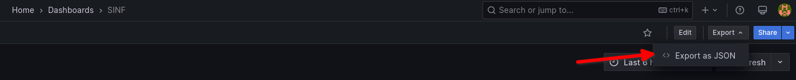
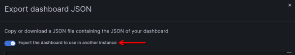
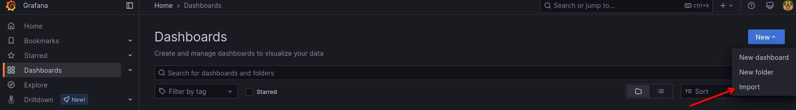
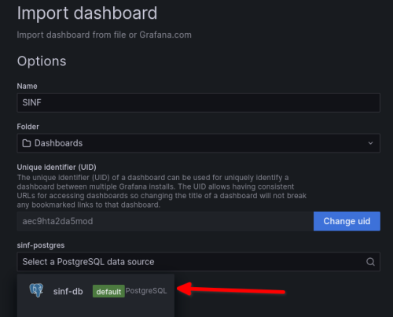

# Usage

## 0. Preparation

1. Begin by reviewing the `docker/docker-compose.yml` file to familiarize yourself with the software components involved. **Please do not make any changes to this file!**

2. The `docker/.env` file contains the default user and password pairs used for various services within the development environment (including database passwords, ports, etc.).

## 1. Start the Services

Use the following commands from the root of your project.
```bash
# Build and start all services
docker compose -f docker/docker-compose.yml up -d --build

# View running containers
docker ps -a

# View logs of a container
docker logs <container_name>

# Open a terminal within a container
docker exec -it <container_name> bash
```

## 2. Access Services

- **PostgreSQL**: `localhost:5432`
- **Dinasore**: `localhost:61499`
- **PgAdmin4**: `http://localhost:8080`
  - Default login credentials will be in your `docker/.env`
- **Grafana**: `http://localhost:8081`
  - Default login credentials will be in your `docker/.env`

## 3. Stopping the Services

Use the following commands from the root of your project.
```bash
# Stop and remove containers
docker compose -f docker/docker-compose.yml down

# Stop and remove containers and volumes.
# Running this will make you loose all the persistent data previously stored!
docker compose -f docker/docker-compose.yml down -v --remove-orphans
```

## 4. Using 4DIAC-IDE

4DIAC-IDE can be found in the `4diac-ide` subdirectory. To start the application, run the executable located in that subdirectory (e.g. `$ ./4diac-ide/4diac-ide`).

## 5. Persistent Storage

> This is important to synchronize changes within your team. **You will need to manually back up your PostgreSQL and Grafana's configurations.**
>
> If you make changes to your database or Grafana's dashboard, **please ensure that your (configuration) backups are stored securely; otherwise, you risk losing all your progress.**

### 5.1. To backup Grafana

1. Select your dashboard. Go to `Export` and `Export as JSON`



2. Activate the `Export the dashboard to use in another instance` and download the file. This will download a .JSON file that can be used to import your configurations.



> **Save the file on `docker/data/grafana/` and push the changes to GitLab.**

### 5.2 To load your Grafana backup

1. Go to the `Dashboards` section and select `Import`.



2. **Load the .JSON file and select the appropriate data source.** You should point to your PostgreSQL server.



### 5.3. To backup PostgreSQL

To save your database data, execute the following command from the project's root directory:

```bash
docker exec -t postgres pg_dump -c -U sinf sinf > docker/data/postgres/dump.sql
```

This will generate an .sql file located in `docker/data/postgres`. **You can then push the dump file to your remote repository to share it** with your colleagues.

This backup will be particularly useful in the event that you delete all your data.

### 5.4 To load your PostgreSQL backup

To restore PostgreSQL using your backup, start the container and run the following command:

```bash
cat docker/data/postgres/dump.sql | docker exec -i postgres psql -U sinf
```